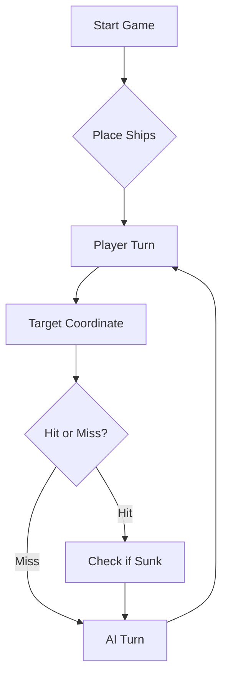

# ⚓ Battleship 2.0

🎥 **Vídeo 1 (Parte B): demonstração das funcionalidades:** https://youtu.be/bRIOaPX4xFg
🎥 **Vídeo 2 (Parte C/D): interação do programa com o LLM:** https://youtu.be/ReB_CnfHNgY


> A modern take on the classic naval warfare game, designed for the XVII century setting with updated software engineering patterns.

---

## 📖 Table of Contents
- [Project Overview](#-project-overview)
- [Key Features](#-key-features)
- [Technical Stack](#-technical-stack)
- [Installation & Setup](#-installation--setup)
- [Code Architecture](#-code-architecture)
- [Roadmap](#-roadmap)
- [Contributing](#-contributing)

---

## 🎯 Project Overview
This project serves as a template and reference for students learning **Object-Oriented Programming (OOP)** and **Software Quality**. It simulates a battleship environment where players must strategically place ships and sink the enemy fleet.

### 🎮 The Rules
The game is played on a grid (typically 10x10). The coordinate system is defined as:

$$(x, y) \in \{0, \dots, 9\} \times \{0, \dots, 9\}$$

Hits are calculated based on the intersection of the shot vector and the ship's bounding box.

---

## ✨ Key Features
| Feature | Description | Status |
| :--- | :--- | :---: |
| **Grid System** | Flexible $N \times N$ board generation. | ✅ |
| **Ship Varieties** | Galleons, Frigates, and Brigantines (XVII Century theme). | ✅ |
| **AI Opponent** | Heuristic-based targeting system. | 🚧 |
| **Network Play** | Socket-based multiplayer. | ❌ |

---

## 🛠 Technical Stack
* **Language:** Java 17
* **Build Tool:** Maven / Gradle
* **Testing:** JUnit 5
* **Logging:** Log4j2

---

## 🚀 Installation & Setup

### Prerequisites
* JDK 17 or higher
* Git

### Step-by-Step
1. **Clone the repository:**
   ```bash
   git clone [https://github.com/britoeabreu/Battleship2.git](https://github.com/britoeabreu/Battleship2.git)
   ```
2. **Navigate to directory:**
   ```bash
   cd Battleship2
   ```
3. **Compile and Run:**
   ```bash
   javac Main.java && java Main
   ```

---

## 📚 Documentation

You can access the generated Javadoc here:

👉 [Battleship2 API Documentation](https://britoeabreu.github.io/Battleship2/)


### Core Logic
```java
public class Ship {
    private String name;
    private int size;
    private boolean isSunk;

    // TODO: Implement damage logic
    public void hit() {
        // Implementation here
    }
}
```

### Design Patterns Used:
- **Strategy Pattern:** For different AI difficulty levels.
- **Observer Pattern:** To update the UI when a ship is hit.
</details>

### Logic Flow


---

## 🗺 Roadmap
- [x] Basic grid implementation
- [x] Ship placement validation
- [ ] Add sound effects (SFX)
- [ ] Implement "Fog of War" mechanic
- [ ] **Multiplayer Integration** (High Priority)

---

## 🧪 Testing
We use high-coverage unit testing to ensure game stability. Run tests using:
```bash
mvn test
```

> [!TIP]
> Use the `-Dtest=ClassName` flag to run specific test suites during development.

---

## 🤝 Contributing
Contributions are what make the open-source community such an amazing place to learn, inspire, and create.

1. Fork the Project
2. Create your Feature Branch (`git checkout -b feature/AmazingFeature`)
3. Commit your Changes (`git commit -m 'Add some AmazingFeature'`)
4. Push to the Branch (`git push origin feature/AmazingFeature`)
5. Open a **Pull Request**

---


## 📄 License
Distributed under the MIT License. See `LICENSE` for more information.

---
**Maintained by:** [@britoeabreu](https://github.com/britoeabreu)  
*Created for the Software Engineering students at ISCTE-IUL.*


## Ficha laboratorial nº 2 - Parte B, Passo 2: Dependências do Maven

### Pergunta 1: Como é que o Maven descobre quais são as dependências transitivas?

O Maven descobre as dependências transitivas lendo o ficheiro `.pom` de cada
biblioteca. Cada artefacto publicado no Maven Central inclui o seu próprio POM,
onde declara as bibliotecas de que ele próprio depende. O Maven lê o `pom.xml`
do projeto, obtém as dependências diretas e, para cada uma, descarrega e lê o
respetivo POM para descobrir as suas dependências. Repete este processo
recursivamente até construir a árvore completa de dependências.

Por exemplo, o projeto declara diretamente `spring-boot-starter-web`, mas o POM
desta biblioteca indica que depende de `spring-web`, `spring-webmvc`,
`tomcat-embed-core`, `jackson-databind`, entre outras, que o Maven também
descarrega automaticamente. A árvore completa pode ser consultada na janela
Maven do IntelliJ (Dependencies) ou com o comando `mvn dependency:tree`.

### Pergunta 2: Porque é que as compilações seguintes são mais rápidas?

Na primeira compilação, o Maven descarrega do repositório remoto (Maven Central)
os ficheiros `.pom` e `.jar` de todas as dependências, diretas e transitivas, e
guarda-os no repositório local do computador (`~/.m2/repository`). Nas
compilações seguintes, o Maven verifica primeiro o repositório local, encontra
lá tudo o que precisa e não volta a descarregar nada, evitando o acesso à rede.
Só volta a descarregar se for alterada a versão de uma dependência no
`pom.xml` ou se o repositório local for apagado.


## Documentação
Site de documentação técnica (Javadoc): https://razoes24.github.io/Battleship2/


## Prompt final da estratégia do oponente de IA

LLM usado: Gemini Pro. O prompt foi treinado por *few-shot prompting* em várias partidas contra o jogo, e a evolução (falhas encontradas e correções) está em [docs-ia](docs-ia/).

Ordem de uso numa conversa nova: (1) prompt da frota, (2) prompt do protocolo JSON, (3) o prompt abaixo.

# Estratégia do oponente de IA

## 1. Diário de Bordo (memória)
Mantém sempre um Diário de Bordo, numerando as rajadas sequencialmente (Rajada 1, 2, 3...).
Para cada tiro regista as coordenadas exatas (ex.: C7) e o resultado: Água, Acerto em <tipo de navio>,
ou <tipo de navio> afundado. Antes de gerar cada rajada, relê o Diário de Bordo completo.
Nunca assumas nada que não conste do diário ou do último JSON de resposta recebido.

Formato de cada entrada:

    Rajada 3: C7 -> Água | D2 -> Acerto em Nau | J10 -> Água

## 2. Regras de tiro
- O tabuleiro tem linhas A a J e colunas 1 a 10. Não dispares fora destes limites (ex.: K4, B12).
- Não repitas coordenadas já disparadas, nem dentro da mesma rajada.
- Única exceção: na última rajada do jogo, quando só faltar afundar o que resta e não existirem
  3 posições novas, completa os 3 tiros obrigatórios repetindo posições já testadas.
- Cada rajada tem sempre exatamente 3 tiros.

## 3. Como ler o JSON de resposta do jogo
O jogo responde com um JSON agregado da rajada, sem dizer qual dos 3 tiros fez o quê:
- `hitsOnBoats`: acertos em navios que não os afundaram.
- `sunkBoats`: navios afundados nesta rajada (o tiro que afunda NÃO conta em `hitsOnBoats`).
- `missedShots`: tiros na água. `repeatedShots` e `outsideShots`: erros teus.

Como não sabes qual tiro acertou, marca os tiros da rajada como candidatos e confirma-os nas
rajadas seguintes, disparando nas posições vizinhas de cada candidato.
Se a resposta indicar 0 acertos e 0 afundados, todos os 3 tiros foram água.

Eliminar candidatos: um navio nunca toca noutro, nem na diagonal. Por isso um candidato que seja
vizinho (incluindo na diagonal) de um navio já confirmado NÃO pode ser parte de outro navio.
Exemplo: se B4 é Galeão confirmado, B5 não pode ser uma Barca.

Só podes excluir as vizinhas de uma Barca afundada depois de saberes qual das posições
candidatas era a Barca.

Regista os candidatos assim, e não rotules nenhum como "Possível Água" isoladamente:
Rajada 3: G6 / I8 / B5 -> 1 Barca afundada (um destes 3), os outros 2 são água

Emparelhar candidatos: um navio de tamanho N é uma linha reta de N posições adjacentes.
Quando um acerto numa rajada e o afundamento do mesmo navio noutra rajada têm candidatos,
procura os pares de candidatos adjacentes: se só existir um par, essa é a posição exata.
Exemplo: acerto em Caravela entre C4/C1/A3 e afundamento entre D1/E3/G5 -> só C1 e D1 são
adjacentes, logo a Caravela é C1-D1.

Só escreves "confirmado" no diário quando a posição exata foi deduzida assim. Se ainda
houver dúvida, escreve "por confirmar" e lista os candidatos. Quando um navio fica confirmado,
marca logo o halo à volta dele.

## 4. Fase de caça e acompanhamento de acertos
- **Caça:** enquanto não houver alvos, dispara em padrão de xadrez (só casas de uma cor), para cobrir
  a maior área com o mínimo de tiros. Não dispares ao acaso.
- **Foco:** depois de um acerto, a prioridade máxima é disparar nas posições contíguas (Norte, Sul,
  Este, Oeste) para descobrir a orientação do navio.
- **Fim do foco:** quando um navio é afundado, deixa de disparar nas posições contíguas a ele e
  volta ao padrão de caça em áreas ainda inexploradas.

## 5. Geometria dos navios
- Caravelas, naus e fragatas são linhas retas: um acerto implica que o resto do navio está na
  horizontal ou na vertical. As posições diagonais a um acerto são água (a única exceção é o corpo
  do Galeão, que tem forma de T).
- Os navios nunca se tocam, nem na diagonal.
- Se houver acertos que não cabem numa linha reta, considera que pode ser o Galeão e testa as
  quatro orientações possíveis do T.

## 6. Navios afundados e prioridade das regras
Quando um navio for afundado, usa o Diário de Bordo para identificar onde caíram esses tiros.
Marca todas as quadrículas num halo de 1 posição à volta dele (incluindo diagonais) como água
intransitável: não dispares aí.

Se duas regras entrarem em conflito, a ordem de prioridade é:
1. Nunca disparar fora do tabuleiro nem repetir tiros (exceto na última rajada).
2. Nunca disparar no halo de um navio afundado.
3. Acompanhar acertos ainda abertos.
4. Sem alvos abertos, padrão de caça em xadrez.

## 7. Formato da resposta
Responde apenas com o JSON da rajada, sem qualquer texto antes ou depois:

    [ {"row": "A", "column": 5},
      {"row": "C", "column": 10},
      {"row": "F", "column": 5} ]

## 8. Fim do jogo
- Se a tua frota for toda afundada, declara a derrota com honra.
- Se o inimigo se render com a frota toda no fundo do oceano, sê um vencedor magnânimo.

### Como foi evoluindo
- **v1:** blocos de Diário de Bordo, regras de tiro e fase de caça. Falha observada: não usava a regra do não-contacto para resolver candidatos.
- **v2:** acrescentou a leitura do JSON agregado e a eliminação de candidatos. Falha observada: deu como "confirmada" uma posição errada por não emparelhar candidatos adjacentes.
- **v3:** acrescentou o emparelhamento de candidatos adjacentes.
